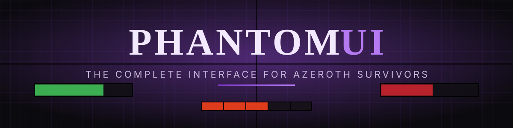

  

  <a href="https://github.com/Phantom2796/PhantomUI/raw/main/download/PhantomUI.zip"><b>⬇ Download</b></a> ·
  <a href="https://phantom2796.github.io/PhantomUI/">Website</a> ·
  <a href="#install">Install</a> ·
  <a href="#commands">Commands</a> ·
  <a href="CHANGELOG.md">Changelog</a>

**PhantomUI** is a complete, modern interface for **Azeroth Survivors**. One addon replaces the classic look with a dark, flat style – crisp black borders, purple accents – and puts the frames, minimap, damage meter, floating damage numbers and an ability plan under one roof. Everything is movable, everything lives in one settings window, and it works in all 10 game languages. PhantomUI's own menus are translated into all 14 game languages (English, Deutsch, Français, Español, Português, Polski, Čeština, Română, Türkçe, Русский, Українська, 简体中文, 日本語, 한국어) – picked automatically from your game language, or set it under General → Language.

> No other UI addon needed. SurvivorsDragonUi, CompactSCT and AZS Spell Meter are all built in.

---

## ✨ Features

### 🖥️ Interface
- **Player & target frames** – name, health as current/max with the bar running into the % field, portrait, level; optional class or enemy type box (**B** boss · **W** guardian · **E** elite)
- **Action bar** – flush buttons without background, crisp icons, cooldown sweep only when a spell is really on cooldown
- **Alerts under the chat** – boss approaches, boss defeated, guardian slain, lair reclaimed and the game's error lines, small and colour-coded instead of big banners
- **Combo points** use the game's own display, movable in anchor mode; warriors get a red rage bar, every other class none
- **Run timer** – time above the bar, boss skulls on it (red = alive, green = dead), next boss with name and countdown below; follows the real run length (16 *and* 20 minute zones)
- **Boss & guardian health bars** – docked above the target frame (same width), more bosses stack upwards; in anchor mode freely movable with their own width, height and scale
- **Run stats under the player frame** – the numbers from the character pane (damage, haste, crit, echo, lifesteal, gold, luck …), always visible
- **Square minimap** that rotates with you, zone text, clock, one button strip for all addons
- **Party frames for co-op** – allies in class colour, click to target, and an ally nameplate in class colour
- **Totems & pets above the player frame** – just the icon with the number inside: active Searing/Magma Totems for shamans (cooldown and duration read from the game, talents included) and every summon the game reports for your class – hunter beasts, treants, spirit wolves, water elemental and every warlock demon – with how many are out
- **Retail-style buffs**, XP bar, gold & next-cache counter, compact game menu, styled nameplates
- **Clean chat** – transparent and movable, modern Roboto font, flat input line, old lines fade after 10 s

### 📊 Damage meter
- Per-ability damage, DPS, share and kills
- Flip with the arrows: **Damage · Boss damage · Healing** – straight from the game's own numbers
- The right icon for every spell, talent proc and jewel in all 10 languages (read from the game data)
- Adjustable background, scale and row height; per-row checkbox hides that source's floating numbers

### 💥 Floating damage numbers
- Compact numbers with the spell icon in a fan above your hero (or above the enemy that was hit), red crits, merged hits with their count (`238.3k x37`)
- Size, font, spread, opacity and a minimum size (in % of your biggest hit) so the screen stays readable
- Built to stay smooth when the numbers hail down

### 📜 Ability & item plan
- `/plan` – click your class's abilities, then necklace, rings and trinkets in the order you want them
- Saved per class; a small window shows the plan during the run, abilities you took and items you wear disappear from it; a small "Plan" button under the XP bar opens the editor
- Tooltips show each item's effect with its base value

### 🧭 Layout & settings
- `/pui` – one settings window with tabs for everything
- **Anchor mode** like ElvUI: drag any frame, edges change width/height, the corner scales
- Grid with black centre lines, numbered axes and mirrored line colours for perfectly symmetric layouts
- Textures, fonts, sizes, colours and an on/off switch for every part

---

## 📦 Install
1. Download the [zip](https://github.com/Phantom2796/PhantomUI/raw/main/download/PhantomUI.zip) – always the newest version.
2. Unzip so the folder sits at `benilla-config/AddOns/PhantomUI/PhantomUI.toc`.
3. Disable SurvivorsDragonUi; delete old `CompactSCT` / `AZSSpellMeter` folders – they are part of PhantomUI now.
4. Start the game (a full restart after updating, not just `/reload`, when new files were added).

Your settings live in `benilla-config/saved/PhantomUI.lua` and survive updates.

## ⌨️ Commands
| Command | |
|---|---|
| `/pui` | settings window |
| `/pui unlock` · `/pui lock` | anchor mode on / off |
| `/pui reset` | every frame back to the default layout |
| `/pui lang auto` · `en` · `de` · `fr` · `es` · `pt` · `pl` · `cs` · `ro` · `tr` · `ru` · `uk` · `zh` · `ja` · `ko` | language of PhantomUI's menus and texts |
| `/pui combo` | shows what the game reports for combo points (for bug reports) |
| `/plan` | ability & item plan editor |
| `/azsm` | damage meter: show, hide, reset, resetpos |
| `/csct` | floating numbers settings |

## ❓ Good to know
- **Plan in the main menu?** Not possible – the main menu is drawn by the game before addons load. Plan once with `/plan` in any run; it is saved per class.
- **Can it pick cards or pause the game?** No – the game offers addons no way to do either.
- **After a game update** most things keep working, because PhantomUI reads the game's own data. If something looks off, open an issue with a screenshot.

## 📝 Credits
Made by **Nobby** for Azeroth Survivors. Chat font: Roboto (Apache License 2.0, see `PhantomUI/media/Roboto-LICENSE.txt`).
